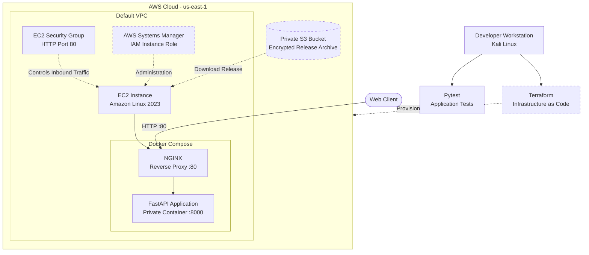

# AWS NGINX Platform
A containerized web application deployment project using FastAPI, NGINX, Docker, AWS EC2, Amazon S3, and Terraform. The project demonstrates reverse proxy configuration, infrastructure as code, secure instance access, automated application deployment, and health monitoring.

## Architecture



## Architecture notes
- NGINX is the public-facing reverse proxy and forwards requests to FastAPI.
- FastAPI listens on port 8000 inside the Docker network; it is not published directly to the internet.
- Terraform defines AWS infrastructure and configuration.
- A private, encrypted S3 bucket stores the application release archive.
- An EC2 instance IAM role provides access to AWS Systems Manager and is intended to grant access only to the required release artifact.
- The security group permits HTTP traffic on port 80. SSH access is not configured.
- HTTPS, a custom domain, automated CI/CD, and CloudWatch dashboards are future enhancements.

Dashed connections indicate planned or not-yet-verified integrations, not confirmed operational services.

## Technology Stack

| Area | Technology |
|---|---|
| Backend API | Python, FastAPI |
| Web server | NGINX |
| Containers | Docker, Docker Compose |
| Cloud infrastructure | AWS EC2, VPC, IAM, S3 |
| Infrastructure as code | Terraform |
| Instance administration | AWS Systems Manager |
| Testing | Pytest, FastAPI TestClient |
| Operating system | Kali Linux for development; Amazon Linux 2023 planned for EC2 |

## Application Endpoints

| Endpoint | Purpose |
|---|---|
| `/` | Application status and service information |
| `/health` | Health check with a UTC timestamp |
| `/api/info` | Application and environment metadata |

## Local Development

### Prerequisites

- Python 3.12 or compatible
- Docker Engine
- Docker Compose
- Terraform
- AWS CLI for cloud operations

### Run the application

```bash
git clone <YOUR_REPOSITORY_URL>
cd aws-nginx-platform

python -m venv .venv
source .venv/bin/activate

python -m pip install -r app/requirements.txt
python -m pip install pytest

PYTHONPATH=app python -m pytest tests/ -v
```

If the project is already on your workstation, skip the clone step.

### Run with Docker Compose

```bash
sudo docker compose up --build -d
sudo docker compose ps
```

The development Compose configuration publishes NGINX at `http://127.0.0.1:8081`.

Test the endpoints:

```bash
curl -i http://127.0.0.1:8081/
curl -i http://127.0.0.1:8081/health
curl -i http://127.0.0.1:8081/api/info
```

Inspect application logs:

```bash
sudo docker compose logs --tail=100 app nginx
```

Stop the development services:

```bash
sudo docker compose down
```

## AWS Deployment

The intended deployment workflow is:

1. Build and test the application locally.
2. Package the application and production Compose configuration.
3. Upload the release archive to a private S3 bucket with server-side encryption.
4. Use Terraform to provision EC2, the security group, the IAM role, and the instance profile.
5. Allow the instance to retrieve the release artifact using restricted IAM permissions.
6. Install Docker and start the application through the instance bootstrap process.
7. Validate the application through the public HTTP endpoint.
8. Verify instance access through AWS Systems Manager.

### Terraform commands

Initialize the Terraform working directory:

```bash
terraform -chdir=terraform init
```

Format and validate:

```bash
terraform -chdir=terraform fmt
terraform -chdir=terraform validate
```

Review the deployment plan:

```bash
terraform -chdir=terraform plan \
  -var="deployment_bucket=<YOUR_PRIVATE_BUCKET_NAME>"
```

Review all proposed changes before applying. EC2 and related AWS resources may incur charges.

## Security Considerations

- Keep AWS access keys out of source control.
- Use an EC2 IAM role instead of storing AWS credentials on the instance.
- Restrict S3 permissions to the required release artifact.
- Block public access to the deployment bucket.
- Require IMDSv2 for EC2 instance metadata.
- Keep the FastAPI container port private.
- Do not expose SSH publicly; use Systems Manager where correctly configured.
- Use HTTPS before handling real users or sensitive information.
- Pin and verify deployment dependencies and container images before production use.

## Project Status

**Current status: development and deployment preparation.**

| Component | Status |
|---|---|
| FastAPI application | Source code present |
| Dockerfile | Present |
| Development Docker Compose | Present |
| NGINX reverse proxy configuration | Present |
| Terraform configuration | Present; deployment requires further validation |
| Encrypted S3 deployment archive | Uploaded; contents should be verified |
| EC2 deployment | Not yet confirmed |
| Systems Manager connectivity | Not yet confirmed |
| HTTPS and custom domain | Planned |
| CloudWatch monitoring and dashboards | Planned |
| Automated CI/CD | Planned |

## Future Improvements

- Add GitHub Actions for automated tests and deployment.
- Configure CloudWatch logs, metrics, and alarms.
- Add HTTPS using a domain and an appropriate TLS termination setup.
- Add deployment rollback and release versioning.
- Introduce vulnerability scanning for container images and dependencies.
- Add infrastructure checks and security tests to the CI pipeline.

## Learning Outcomes

This project is intended to demonstrate practical skills in:

- Linux administration and troubleshooting
- Containerization and reverse proxy design
- AWS infrastructure provisioning with Terraform
- IAM least-privilege access and secure instance administration
- API health checks and automated testing
- Deployment packaging and operational monitoring

---

**Note:** This project is still being deployed. The architecture describes the intended system, not proof that all AWS components are running.
